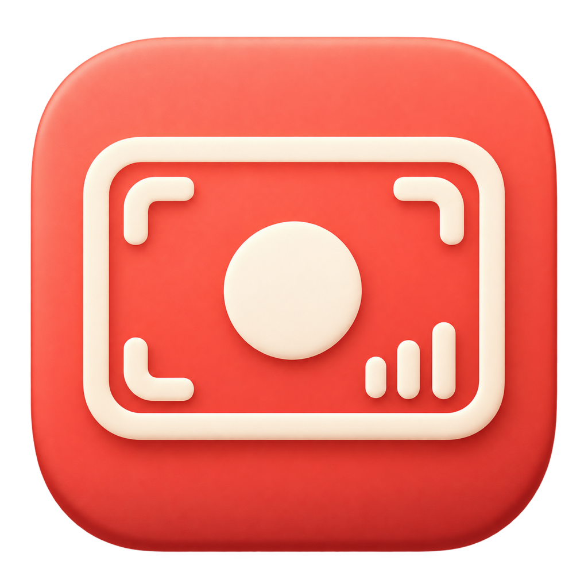

# 本机录屏 · Mac Screen Recorder



一个原生、离线的 macOS 录屏工具：录制画面和系统声音，可选择是否加入麦克风人声。通过按钮、菜单栏和全局快捷键操作，不需要 Codex、大模型 API、账号或后台服务器。

本仓库同时提供 **独立 App、完整源码和可选 Codex skill**。App 不依赖 skill；skill 只是帮助编码助手打开和维护它。

## 下载

前往 [v0.2.1 测试版下载页](https://github.com/liammactavish007-glitch/mac-screen-recorder/releases/tag/v0.2.1)：

- `MacScreenRecorder-0.2.1-macos-arm64.zip`：解压后得到 `本机录屏.app`，可独立使用。
- `mac-screen-recorder-skill-0.2.1.zip`：可选 Codex skill，含可编译的完整原生源码。
- `mac-screen-recorder-source-0.2.1.zip`：完整仓库源码。
- `SHA256SUMS.txt`：下载文件的 SHA-256 校验值。

要求：**Apple Silicon（M 系列芯片）、macOS 15 或更新版本**。当前不提供 Intel Mac、Windows 或 Linux 二进制。界面目前为中文。

**分发限制：** 当前 App 使用 ad-hoc 本机签名，没有 Apple Developer ID 签名或公证。下载到其他 Mac 后可能受到 Gatekeeper 提示或拦截。这是测试版，不代表已经通过跨设备安装验收。可先审查源码并自行编译；不要关闭 Gatekeeper、SIP 或其他系统安全机制。[Apple 官方分发说明](https://developer.apple.com/developer-id/)

## 使用

1. 解压 App，放入你的 `~/Applications` 或 `/Applications`，双击打开。
2. 按提示授权屏幕与系统音频录制；只有开启“麦克风（人声）”时才需要麦克风权限。
3. 用“选择画面”选择屏幕、窗口或应用，不选择时默认使用主屏幕。
4. 系统声音默认开启，麦克风默认关闭。开启麦克风后可选择输入设备。
5. 点击“开始录制”，完成后点击“停止并保存”，等待保存完成再退出。

默认输出到你的 `Movies/本机录屏`，可通过“更改位置”选择目录。每段录像会生成 MP4 和相邻的 JSON 检查报告；报告包含时长、轨道数、音频数据包计数和警告。文件名包含时间和随机后缀，不覆盖已有录像。

| 操作 | 快捷键 |
| --- | --- |
| 开始 / 停止并保存 | `Control + Shift + R` |
| 显示控制窗口 | `Control + Shift + S` |

关闭窗口后 App 仍在菜单栏运行；选择“退出”后快捷键失效。当前未实现开机自动启动、完全退出后通过快捷键唤起、暂停录制或独立音频轨导出。快捷键可能与其他 App 的自定义绑定冲突，仍可使用按钮。

## 功能与边界

- 基于 Apple ScreenCaptureKit、SCRecordingOutput、AVFoundation、AppKit 和 Carbon。
- H.264 MP4；30 / 60 fps；1080p 范围内等比例缩放或原始分辨率。
- 系统声音和可选麦克风由系统录制框架混入输出，不提供单独可编辑音轨。
- 捕获声音与选择的内容相关；需要完整系统声音时使用整屏模式。受保护的内容可能无法录制。
- 缺少所需权限时停止本次录制，不静默遗漏用户要求的人声。
- 保存前检查磁盘空间，空间过低时尝试停止并保存。
- 无网络客户端、遥测、云上传或运行时第三方软件包；录音录像保留在本机。
- 不安装虚拟声卡，不自动录屏，不自动修改系统安全设置。

构建成功不等于录屏已验证。已知测试情况及仍需实测的内容见 [验证说明](docs/VALIDATION.md)。请只录制你有权录制的内容。

## 从源码构建 App

需要 Apple Silicon Mac、macOS 15+ 和支持 macOS 15 API 的 Apple Swift 工具链 / SDK（Xcode 或 Command Line Tools）。直接使用已编译 App 不需要这些开发工具。

在仓库根目录运行：

```sh
zsh scripts/build-app.sh
```

输出为 `dist/本机录屏.app`。也可指定一个绝对 `.app` 路径：

```sh
zsh scripts/build-app.sh "$HOME/Applications/本机录屏.app"
```

替换现有 App 前先停止录制并正常退出。脚本拒绝覆盖其他 bundle ID 的 App，但相同 bundle ID 的输出路径会被重新构建。脚本仅执行本机签名，不执行 Developer ID 签名或公证。

原生源码入口：[Main.swift](skills/mac-screen-recorder/scripts/native/Main.swift) 和 [StudioUI.swift](skills/mac-screen-recorder/scripts/native/StudioUI.swift)。图标资源、源图和生成提示均随源码提供；生成图标属于设计阶段，不是 App 的运行依赖。

## 安装可选 Codex skill

无需 skill 就能使用 App。需要助手打开或维护它时，可将 `skills/mac-screen-recorder` 文件夹放入你的 Codex skills 目录，或在仓库根目录运行：

```sh
zsh scripts/install-skill.sh
```

默认安装到 `${CODEX_HOME:-$HOME/.codex}/skills/mac-screen-recorder`；脚本拒绝覆盖已经安装的同名 skill。也可指定 skills 父目录：

```sh
zsh scripts/install-skill.sh "$HOME/.agents/skills"
```

App 和 skill 分别安装。skill 的 `scripts/open.sh` 会查找 `~/Applications/本机录屏.app` 和 `/Applications/本机录屏.app`，或接受显式 App 路径；不会自动下载、编译或开始录屏。

## 隐私、反馈与许可

本仓库不包含个人录像、机器诊断输出、认证材料或其他工程。提交 issue 时请不要上传私密录像、完整诊断文件或凭据；如需示例，请先去除个人路径和敏感内容。

项目源码与本项目提供的图标资源采用 [MIT License](LICENSE)。Apple 系统框架、系统字体和 SF Symbols 属于系统资源，不被本仓库的 MIT 许可重新授权。本工具按现状提供，无任何保证。
